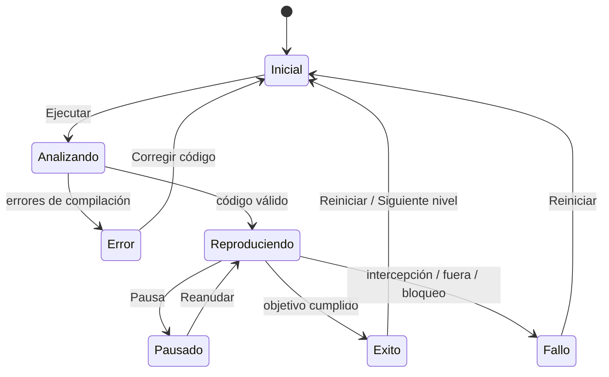
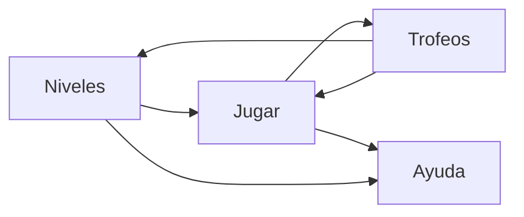
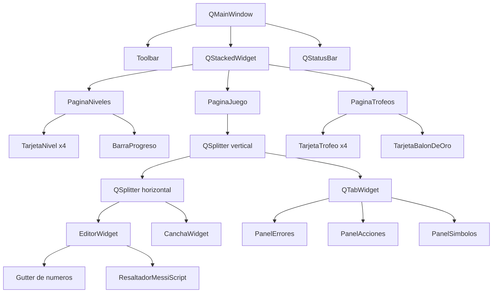
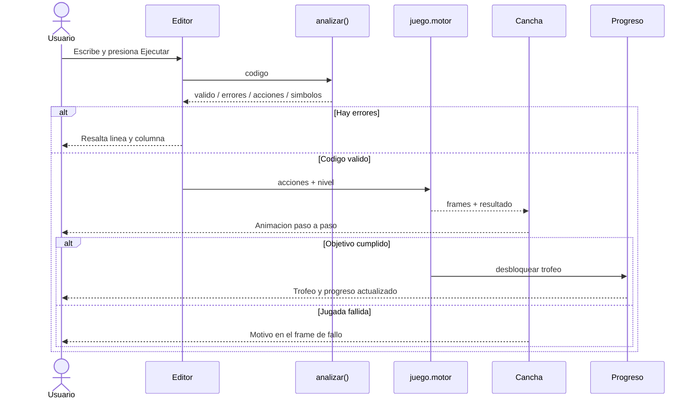

# MessiScript — Plan de implementación y esquema gráfico

**Proyecto:** interfaz para escribir jugadas en MessiScript, simularlas en una cancha 2D cenital y desbloquear trofeos.
**Alcance:** 4 niveles (3 existentes + Inglaterra 2026), ejecución con Python + venv, sin ejecutable dedicado.
**Stack propuesto:** Python 3.14 + PySide6-Essentials 6.12.0 + motor propio en Python puro.

---

## 1. Resumen ejecutivo

La interfaz se construye como una aplicación de escritorio con PySide6. El compilador actual (`messiscript/`) no se modifica: se consume mediante `analizar()`. La lógica del juego vive en un paquete nuevo (`juego/`) sin dependencias de Qt, y la interfaz (`ui/`) solo dibuja y conecta eventos.

La aplicación tendrá tres pantallas principales:

1. **Niveles:** tarjetas de los 4 partidos y estado de progreso.
2. **Jugar:** editor de código + cancha 2D + paneles de errores, acciones y símbolos.
3. **Trofeos:** vitrina con los trofeos desbloqueados y progreso total.

El flujo principal es:

```text
código -> analizar() -> acciones -> motor.simular() -> frames -> animación -> trofeo
```

La decisión clave es separar **validez del código** (compilador) de **éxito de la jugada** (motor). Un programa puede ser válido y aun así fallar porque el remate fue desde muy lejos o porque un rival interceptó el pase. La interfaz debe mostrar ambos resultados.

---

## 2. Alcance

### 2.1 Incluido

- 4 niveles:
  - México 2022.
  - Croacia 2022.
  - Final 2022.
  - Inglaterra 2026 (nuevo).
- Editor con resaltado de sintaxis, números de línea, errores con línea/columna y click-to-line.
- Paneles de errores, acciones y símbolos.
- Cancha 2D cenital con jugadores, pelota, arco, rastro y animación paso a paso.
- Controles de reproducción: ejecutar, pausar/reanudar, reiniciar y velocidad.
- Trofeos, progreso persistente y opción de borrar progreso.
- Ayuda integrada con sintaxis y reglas del juego.
- Tests del motor, integración con el compilador y smoke tests de UI.
- Documentación de instalación y uso.

### 2.2 Fuera de alcance

- 3D, física realista, IA de rivales o partidos completos.
- Multijugador, online, base de datos o cuentas.
- Empaquetado como `.exe`, instalador o `pyside6-deploy`.
- Logos, fotos o escudos oficiales; se usan formas vectoriales simples.
- Ampliar el lenguaje con `SI`, variables reasignables o sensores.
- Más torneos o una carrera completa de Messi.
- Sonido (se puede agregar después; `QtMultimedia` requeriría Addons).

### 2.3 Supuestos

- Python 3.14.7 en Windows 11 x64.
- `PySide6-Essentials==6.12.0` (compatible con Python `>=3.10,<3.16`).
- Ventana objetivo: 1280×800; mínimo 1100×700.
- El compilador sigue funcionando sin PySide6.
- El usuario ejecuta `python main.py` desde la raíz del repo con el venv activado.

---

## 3. Nuevo nivel: Inglaterra 2026

### 3.1 Contexto del partido

Según reportes públicos del Mundial 2026:

- **Partido:** Inglaterra 1–2 Argentina, semifinal.
- **Fecha:** 15 de julio de 2026.
- **Sede:** Atlanta Stadium.
- **Goles:**
  - 55' Anthony Gordon (Inglaterra).
  - 85' Enzo Fernández (asistencia de Messi).
  - 90+2' Lautaro Martínez (asistencia de Messi, centro y cabezazo).
- Argentina avanzó a la final contra España.

El partido tuvo **dos asistencias de Messi**. Este nivel modela la **segunda**, el centro para el cabezazo de Lautaro, porque:

- Es la jugada decisiva que clasifica a la final.
- Se adapta naturalmente a `PASE LAUTARO` + `REMATAR`.
- Permite mostrar la regla de cambio de control después del pase.

La asistencia a Enzo puede agregarse después como variante opcional `INGLATERRA_2026_ENZO`, pero no forma parte del alcance inicial.

### 3.2 Ficha del nivel

| Campo | Valor |
|---|---|
| ID | `INGLATERRA_2026` |
| Nombre | Inglaterra 2026 |
| Subtítulo | Semifinal · Mundial 2026 |
| Escenario | `INGLATERRA_2026` |
| Objetivo | Gol de Lautaro con asistencia de Messi |
| Trofeo | Pase a la final 2026 |
| Dificultad | Media |
| Código inicial | `MOVER`, `PASE LAUTARO`, `REMATAR` + `VAR`/`REPETIR` para demostrar v2 |

### 3.3 Código inicial propuesto

```text
// Semifinal del Mundial 2026: centro de Messi y cabezazo de Lautaro.
INICIAR INGLATERRA_2026
VAR PASOS = 2
MOVER DERECHA PASOS
MOVER ARRIBA 1
PASE LAUTARO
REMATAR
FIN
```

Las coordenadas exactas se ajustan en `juego/niveles.json` para que este código gane. El ejemplo usa `VAR` y `REPETIR` no es obligatorio; alcanza con movimientos simples. Se puede incluir una versión con `REPETIR` si se quiere lucir la v2:

```text
INICIAR INGLATERRA_2026
VAR PASOS = 2
REPETIR 1 {
    MOVER DERECHA PASOS
    MOVER ARRIBA 1
}
PASE LAUTARO
REMATAR
FIN
```

### 3.4 Narrativa y pista para el jugador

- **Narrativa:** “Argentina pierde 1–0 hasta el minuto 85. Messi empata con un pase a Enzo y, en el 90+2, cuelga un centro para que Lautaro cabecee el gol de la clasificación.”
- **Objetivo visible:** “Asistí a Lautaro y convertí el gol del pase a la final.”
- **Pista:** “Llegá a la banda derecha, buscá el espacio y tirá el centro al área. Después del pase, el control pasa a Lautaro.”

### 3.5 Fuentes de contexto

- MLSSoccer: *Lionel Messi sparks stunning comeback as Argentina reach World Cup final*.
- FOX Sports: *Lionel Messi delivers 2 clutch assists…*.
- ESPN: resumen del partido Inglaterra 1–2 Argentina (15/07/2026).

> Nota: el juego es una demostración académica. Las posiciones, rivales y tiempos son ilustrativos, no una reconstrucción oficial del partido.

---

## 4. Experiencia de usuario

### 4.1 Flujo principal

1. El usuario abre la app y ve la pantalla de niveles con 4 tarjetas y el progreso (`0/4` a `4/4`).
2. Elige un nivel. La app carga el código inicial, la cancha en estado inicial, el objetivo y la pista.
3. El usuario edita el código o presiona **Ejecutar** directamente.
4. La app analiza:
   - Si hay errores, resalta la línea/columna y muestra el panel de errores. No anima.
   - Si es válido, muestra las acciones y los símbolos, y comienza la simulación.
5. La cancha reproduce la jugada frame a frame; el panel de acciones marca la acción actual.
6. Al terminar:
   - **Éxito:** mensaje “¡Gol!” / “¡Asistencia!”, trofeo desbloqueado y progreso actualizado.
   - **Fallo:** se detiene en el frame del problema y se explica el motivo (intercepción, fuera de la cancha, remate bloqueado, objetivo no cumplido).
7. El usuario puede reiniciar, cambiar la velocidad, volver a niveles o ir a trofeos.

### 4.2 Máquina de estados de la reproducción



### 4.3 Navegación



### 4.4 Atajos de teclado

| Atajo | Acción |
|---|---|
| `F5` / `Ctrl+Enter` | Ejecutar jugada |
| `Espacio` | Pausar / reanudar |
| `R` | Reiniciar reproducción |
| `Ctrl+1` | Ir a Niveles |
| `Ctrl+2` | Ir a Trofeos |
| `F1` | Ayuda |
| `Ctrl+S` | Guardar código en un `.messi` (opcional) |
| `Ctrl+O` | Abrir un `.messi` (opcional) |

---

## 5. Esquema gráfico

### 5.1 Wireframe de la pantalla principal

```text
┌────────────────────────────────────────────────────────────────────────────┐
│  ⚽ MessiScript · Carrera      [Niveles] [Trofeos] [Ayuda]        2/4 🏆  │
├────────────────────────────────────────────────────────────────────────────┤
│  Inglaterra 2026 · Semifinal       Objetivo: asistencia a Lautaro         │
├───────────────────────────────────────────┬────────────────────────────────┤
│  EDITOR                                   │  CANCHA 2D CENITAL             │
│                                           │                                │
│   1  // Semifinal del Mundial 2026        │   ┌────────────────────────┐   │
│   2  INICIAR INGLATERRA_2026              │   │  ░░░░░░░░░░░░░░░░░░░░  │   │
│   3  VAR PASOS = 2                        │   │  ░░░● MESSI      ▲   ░  │   │
│   4  MOVER DERECHA PASOS                  │   │  ░░░   ⚽         ▲   ░  │   │
│   5  MOVER ARRIBA 1                       │   │  ░░░       ○ LAUTARO  ░  │   │
│   6  PASE LAUTARO                         │   │  ░░░            [GK]  ░  │   │
│   7  REMATAR                              │   │  ░░░░░░░░░░░░░░░░░░░░  │   │
│   8  FIN                                   │   └────────────────────────┘   │
│                                           │   ▶ Reproducir   ↺   1x        │
│  [Ejecutar F5]  [Restaurar ejemplo]        │   Acción 4/7 · PASE LAUTARO    │
├───────────────────────────────────────────┴────────────────────────────────┤
│  [Errores]  [Acciones]  [Símbolos]                                         │
│  ✓ Código válido · 7 acciones · 2 símbolos · Objetivo: gol con asistencia │
└────────────────────────────────────────────────────────────────────────────┘
```

### 5.2 Pantalla de niveles

```text
┌────────────────────────────────────────────────────────────────────────────┐
│  MODO CARRERA                                            Progreso: 2/4    │
│  ████████████████████████░░░░░░░░░░░░░░░░░░░░░░░░░░░░░░  50%             │
│                                                                            │
│  ┌──────────────────┐  ┌──────────────────┐  ┌──────────────────┐         │
│  │  🏆 COMPLETADO   │  │  🏆 COMPLETADO   │  │  ○ PENDIENTE     │         │
│  │  México 2022     │  │  Croacia 2022    │  │  Final 2022      │         │
│  │  Gol a México    │  │  Pase a la final │  │  Copa del Mundo  │         │
│  │  [Rejugar]       │  │  [Rejugar]       │  │  [Jugar]         │         │
│  └──────────────────┘  └──────────────────┘  └──────────────────┘         │
│  ┌──────────────────┐                                                      │
│  │  ○ PENDIENTE     │                                                      │
│  │  Inglaterra 2026 │                                                      │
│  │  Pase a la final │                                                      │
│  │  [Jugar]         │                                                      │
│  └──────────────────┘                                                      │
│                                                                            │
│  Todos los niveles están disponibles desde el inicio.                     │
└────────────────────────────────────────────────────────────────────────────┘
```

### 5.3 Pantalla de trofeos

```text
┌────────────────────────────────────────────────────────────────────────────┐
│  TROFEOS                                              2/4 completados     │
│  ████████████████████████░░░░░░░░░░░░░░░░░░░░░░░░░░░░░░  50%             │
│                                                                            │
│  ┌────────────────┐ ┌────────────────┐ ┌────────────────┐ ┌─────────────┐ │
│  │      🏆        │ │      🏆        │ │      🔒        │ │     🔒      │ │
│  │ Boleto a       │ │ Finalista del  │ │ Copa del Mundo │ │ Pase a la   │ │
│  │ octavos        │ │ mundo 2022     │ │ 2022           │ │ final 2026  │ │
│  │ México 2022    │ │ Croacia 2022   │ │ Final 2022     │ │ Inglaterra  │ │
│  └────────────────┘ └────────────────┘ └────────────────┘ └─────────────┘ │
│                                                                            │
│  ┌──────────────────────────────────────────────────────────────────────┐  │
│  │  BALÓN DE ORO: se desbloquea al completar los 4 niveles.            │  │
│  └──────────────────────────────────────────────────────────────────────┘  │
│                                                                            │
│  [Borrar progreso]                                                         │
└────────────────────────────────────────────────────────────────────────────┘
```

Los iconos definitivos serán SVG vectoriales simples, no emojis, para evitar diferencias de renderizado entre máquinas. Los emojis del wireframe son solo ilustrativos.

### 5.4 Cancha 2D cenital

La cancha se dibuja con `QPainter` dentro de un `QWidget`. No se estira: se calcula una escala uniforme y se centra.

```text
Vista cenital · ataque hacia la derecha (x+)

y=0
  ┌──────────────────────────────────────────────────────────────┐
  │  ░░░░░░░░░░░░░░░░░░░░░░░░░░░░░░░░░░░░░░░░░░░░░░░░░░░░░░░░  │
  │  ░░░░░░░░░░░░░░░░░░░░░░░░░░░░░░░░░░░░░░░░░░░░░░░░░░░░░░░░  │
  │  ░░░░░░░░░░░░░░░░░░░░░░░░░░░░░░░░░░░░░░░░░░░░░░░░░░░░░░░░  │
  │  ░░░░░░░░░░░░░░░░░░░░░░░░░░░░░░░░░░░░░░░░░░░░░░░░░░░░░░░░  │
  │  ░░░░░░░░░░░░░░░  ● MESSI  ●  ░░░░░░░░░░░░░░░░░░░░░░░░░░░░  │
  │  ░░░░░░░░░░░░░░░░░░░░ ⚽ ░░░░░░░░░░░░░░░░░░░░░░░░░░░░░░░░░  │
  │  ░░░░░░░░░░░░░░░░░░░░░░░░  ○ LAUTARO  ░░░░░░░░░░░░░░░░░░░░  │
  │  ░░░░░░░░░░░░░░░░░░░░░░░░░░░░░░░░░░  ▲  ▲  ░░░░░░░░░░░░░░░░  │
  │  ░░░░░░░░░░░░░░░░░░░░░░░░░░░░░░░░░░░░░░  [GK]  ░░░░░░░░░░░░  │
  │  ░░░░░░░░░░░░░░░░░░░░░░░░░░░░░░░░░░░░░░░░░░░░░░░░░░░░░░░░  │
  │  ░░░░░░░░░░░░░░░░░░░░░░░░░░░░░░░░░░░░░░░░░░░░░░░░░░░░░░│  │
  └──────────────────────────────────────────────────────────────┘
                                                              arco rival
x=0                                                        x=29
```

**Coordenadas y medidas propuestas:**

| Elemento | Valor |
|---|---|
| Grilla | 30 columnas × 20 filas |
| Celda | ~24 px en 1280×800 |
| Arco rival | x=29, y=8..12 (4 celdas de alto) |
| Área grande | 6 celdas de ancho × 12 de alto |
| Círculo central | radio 3 celdas |
| Jugador | círculo de 26–28 px |
| Pelota | círculo de 10–12 px |
| Rastro | polilínea punteada, 2 px |
| Nombres | solo Messi, poseedor, receptor y rematador; el resto iniciales |

**Colores de la cancha:**

- Fondo: franjas `#166534` y `#15803D`.
- Líneas: `#F8FAFC` con 2 px.
- Jugadores de Argentina: `#75AADB` con borde blanco.
- Messi: `#38BDF8` con anillo `#FBBF24`.
- Rivales: `#DC2626`.
- Arquero rival: `#FACC15` con borde negro.
- Pelota: `#FFFFFF` con borde `#0F172A`.

### 5.5 Sistema visual

**Paleta:**

| Rol | Hex | Uso |
|---|---|---|
| Fondo app | `#0B1220` | Ventana |
| Panel | `#111827` | Editor, cancha, tarjetas |
| Panel elevado | `#1F2937` | Hover, tabs activas |
| Borde | `#334155` | Separadores |
| Texto principal | `#E5E7EB` | Títulos y código |
| Texto secundario | `#9CA3AF` | Ayudas y metadatos |
| Acento Argentina | `#75AADB` | Botones primarios, foco |
| Éxito | `#22C55E` | Gol, trofeo, código válido |
| Dorado | `#FBBF24` | Trofeos, Messi |
| Error | `#EF4444` | Errores, fallo de jugada |
| Advertencia | `#F59E0B` | Escenario incorrecto, avisos |

**Tipografía:**

| Uso | Fuente | Tamaño |
|---|---|---|
| UI general | Segoe UI / Inter | 10–11 pt |
| Títulos | Segoe UI Semibold | 16–20 pt |
| Código | Cascadia Code / Consolas | 11 pt |
| Números de línea | Cascadia Code | 9 pt |
| Nombres en cancha | Segoe UI | 8–9 pt |

**Espaciado y formas:**

- Base 8 px; márgenes 16/24 px.
- Tarjetas con radio 8 px y borde 1 px.
- Botones con radio 6 px; altura 32–36 px.
- Tabs con subrayado de 2 px en acento.
- Sin sombras fuertes; una sombra suave solo en diálogos.

**Componentes:**

- **Top bar:** logo textual, navegación, progreso `n/4` y acceso a ayuda.
- **Tarjeta de nivel:** icono de trofeo, nombre, subtítulo, objetivo, estado y botón.
- **Editor:** gutter de números, línea actual resaltada, subrayado de error, fuente monoespaciada.
- **Cancha:** fondo verde, jugadores, pelota, rastro, chip de acción y barra de progreso.
- **Tabs:** Errores, Acciones, Símbolos; contadores en el título (`Errores (2)`).
- **Status bar:** estado, nivel, acción actual, velocidad.
- **Diálogo de trofeo:** icono, nombre, descripción, botones “Siguiente nivel” y “Ver trofeos”.

### 5.6 Comportamiento visual de la animación

- Cada acción se divide en frames:
  - `MOVER`: un frame por celda.
  - `PASE`: 8 frames a lo largo de la línea.
  - `REMATAR`: 8–10 frames hacia el arco.
- Intervalo base: 120 ms por frame; velocidades 0.5×, 1× y 2×.
- El chip de acción muestra `Acción 4/7 · PASE LAUTARO`.
- La barra inferior avanza de 0 a 100 %.
- El rastro se dibuja solo hasta el frame actual.
- En éxito: destello verde y texto “¡GOL!” durante ~1 s.
- En fallo: borde rojo en la cancha, frame congelado y mensaje con el motivo.
- No hay transiciones largas ni animaciones decorativas que retrasen la demo.

### 5.7 Accesibilidad y usabilidad

- Contraste mínimo AA entre texto y fondo.
- No depender solo del color: iniciales, iconos y etiquetas de texto.
- Todos los controles accesibles por teclado; foco visible.
- Tooltips en botones de icono.
- Mensajes de error en español, con línea y columna.
- El editor no autocorrige mayúsculas: el lenguaje es sensible a mayúsculas.
- La cancha se adapta al tamaño de la ventana sin deformar círculos.

### 5.8 Árbol de componentes



---

## 6. Arquitectura técnica

### 6.1 Principios

1. **El compilador no se toca.** `messiscript/Scanner.py`, `Parser.py`, `semantica.py` y `analizador.py` quedan igual. Solo se agrega el escenario `INGLATERRA_2026` a `escenarios.json` y se actualiza el README.
2. **El motor no sabe de Qt.** `juego/` es Python puro, testeable sin interfaz.
3. **La UI no decide reglas.** Los widgets dibujan frames y emiten señales; el controlador llama a `analizar()` y `simular()`.
4. **Los datos mandan.** Niveles, posiciones, objetivos y trofeos viven en JSON; agregar un nivel no debería requerir cambios de código.
5. **El compilador sigue siendo independiente.** `python analizar.py` y `python -m unittest -v` funcionan sin PySide6.

### 6.2 Diagrama de arquitectura

```mermaid
flowchart LR
    U[Usuario] --> UI[ui/ · PySide6]
    UI -->|codigo fuente| A[analizar()]
    A --> C[messiscript/ · Scanner + Parser + Semantica]
    A -->|valido, errores, acciones, simbolos| UI
    UI -->|acciones + nivel| M[juego/motor.py]
    M -->|frames + resultado| UI
    UI -->|nivel completado| P[juego/progreso.py]
    P -->|trofeos y progreso| UI
    UI -->|dibuja| Q[CanchaWidget]
```

### 6.3 Flujo de una ejecución



### 6.4 Estructura de archivos

```text
main.py
requirements-ui.txt
juego/
  __init__.py
  modelos.py
  motor.py
  niveles.py
  progreso.py
  niveles.json
ui/
  __init__.py
  ventana.py
  editor.py
  resaltador.py
  cancha.py
  paneles.py
  niveles_vista.py
  trofeos_vista.py
  ayuda.py
  estilos.qss
tests/
  test_motor.py
  test_integracion.py
  test_progreso.py
  test_ui_smoke.py
```

No se crean archivos dentro de `messiscript/` salvo la actualización de datos y README.

### 6.5 Responsabilidades

| Módulo | Responsabilidad |
|---|---|
| `main.py` | Verifica PySide6, crea `QApplication`, carga estilos y abre la ventana |
| `juego/modelos.py` | Dataclasses `Nivel`, `Jugador`, `Objetivo`, `Frame`, `Resultado` |
| `juego/niveles.py` | Carga y valida `niveles.json`; construye escenarios para el analizador |
| `juego/motor.py` | Simula acciones, genera frames y evalúa objetivos |
| `juego/progreso.py` | Lee/escribe `~/.messiscript/progreso.json` |
| `ui/ventana.py` | `QMainWindow`, toolbar, `QStackedWidget`, controlador de flujo |
| `ui/editor.py` | Editor con gutter, resaltado, subrayado de errores y atajos |
| `ui/resaltador.py` | `QSyntaxHighlighter` para MessiScript |
| `ui/cancha.py` | Dibujo de cancha y reproducción de frames |
| `ui/paneles.py` | Tablas de errores, acciones y símbolos |
| `ui/niveles_vista.py` | Tarjetas y progreso de niveles |
| `ui/trofeos_vista.py` | Vitrina, progreso y reset |
| `ui/ayuda.py` | Sintaxis, reglas y atajos |

### 6.6 Datos de nivel

`juego/niveles.json` es la fuente de verdad del juego. Ejemplo para Inglaterra 2026:

```json
{
  "id": "INGLATERRA_2026",
  "nombre": "Inglaterra 2026",
  "subtitulo": "Semifinal · Mundial 2026",
  "escenario": "INGLATERRA_2026",
  "descripcion": "Argentina pierde 1-0 hasta el minuto 85. Messi asiste a Enzo para el empate y, en el 90+2, cuelga el centro para el cabezazo de Lautaro.",
  "codigo_inicial": "INICIAR INGLATERRA_2026\nVAR PASOS = 2\nMOVER DERECHA PASOS\nMOVER ARRIBA 1\nPASE LAUTARO\nREMATAR\nFIN",
  "pista": "Llegá a la banda derecha y tirá el centro al área para Lautaro.",
  "cancha": {"columnas": 30, "filas": 20},
  "jugadores": ["MESSI", "ALVAREZ", "ENZO_FERNANDEZ", "MAC_ALLISTER", "DE_PAUL", "LAUTARO", "OTAMENDI", "ROMERO"],
  "nombres": {
    "MESSI": "Messi",
    "ALVAREZ": "Álvarez",
    "ENZO_FERNANDEZ": "Enzo",
    "MAC_ALLISTER": "Mac Allister",
    "DE_PAUL": "De Paul",
    "LAUTARO": "Lautaro",
    "OTAMENDI": "Otamendi",
    "ROMERO": "Romero"
  },
  "inicio": {
    "MESSI": [22, 6],
    "LAUTARO": [27, 10],
    "ALVAREZ": [24, 14],
    "ENZO_FERNANDEZ": [18, 10],
    "MAC_ALLISTER": [16, 7],
    "DE_PAUL": [14, 12],
    "OTAMENDI": [8, 10],
    "ROMERO": [7, 8]
  },
  "rivales": {
    "PICKFORD": [28, 10],
    "STONES": [25, 9],
    "GUEHI": [25, 11],
    "RICE": [20, 10],
    "BELLINGHAM": [18, 14],
    "SAKA": [12, 5],
    "GORDON": [11, 15]
  },
  "arquero": "PICKFORD",
  "pelota": "MESSI",
  "arco": {"x": 29, "y": 8, "alto": 4},
  "objetivo": {
    "tipo": "gol_con_asistencia",
    "asistente": "MESSI",
    "rematador": "LAUTARO",
    "max_acciones": 8
  },
  "trofeo": {
    "id": "pase_final_2026",
    "nombre": "Pase a la final 2026",
    "descripcion": "Asistencia de Messi a Lautaro en el 90+2."
  }
}
```

**Reglas de validación al cargar:**

- IDs únicos.
- `escenario` existe en el compilador o se inyecta desde el nivel.
- Todos los jugadores de `inicio` están en `jugadores`.
- El portador de `pelota` existe y empieza dentro de la cancha.
- Las posiciones están dentro de `cancha`.
- El arco está dentro de la cancha.
- El objetivo referencia jugadores existentes.
- El trofeo tiene ID y nombre.

### 6.7 Progreso

Archivo: `~/.messiscript/progreso.json` (Windows: `C:\Users\<usuario>\.messiscript\progreso.json`).

```json
{
  "version": 1,
  "niveles_completados": ["MEXICO_2022", "CROACIA_2022"],
  "ultimo_nivel": "INGLATERRA_2026"
}
```

- Se guarda al ganar un nivel.
- Si el archivo no existe, se crea vacío.
- Si está corrupto, se ignora, se muestra un aviso y se empieza de cero.
- Los tests usan una ruta temporal; nunca tocan el progreso real.
- El botón “Borrar progreso” pide confirmación y reescribe el archivo.

### 6.8 Motor de simulación

**API:**

```python
def simular(acciones: list[dict], nivel: Nivel) -> Resultado:
    ...
```

**Entrada:** acciones expandidas por el compilador (`MOVER`, `PASE`, `REMATAR`).
**Salida:** `Resultado` con `exito`, `motivo`, `frames`, `acciones_ejecutadas` y `trofeo`.

**Reglas:**

1. **Grilla:** 30×20. `x` crece a la derecha; `y` crece hacia abajo.
2. **Posesión:** al inicio, el portador es `nivel.pelota` (Messi).
3. **`MOVER`:** mueve al portador una celda por paso. La pelota lo acompaña.
   - Fuera de la cancha: fallo.
   - Celda ocupada por rival: fallo por choque.
   - Celda ocupada por compañero: fallo por ocupación (regla simple para el prototipo).
4. **`PASE`:** el portador pasa al jugador indicado.
   - Si el receptor no está en el nivel, el compilador ya lo rechazó.
   - Si un rival está en la línea de pase, intercepción: fallo.
   - Si llega, el receptor pasa a ser el nuevo portador y se registra `ultimo_pase = (pasador, receptor)`.
5. **`REMATAR`:** el portador remata.
   - Si la distancia al arco supera `alcance` (por ejemplo, 8 celdas): fallo por distancia.
   - Si un rival bloquea la línea al arco: fallo por bloqueo/atajada.
   - Si convierte: se registra gol y se evalúa el objetivo.
6. **Objetivos:**
   - `gol`: gol del `rematador` indicado (o de cualquier jugador si no se indica).
   - `asistencia`: pase completado de `asistente` a `receptor`.
   - `gol_con_asistencia`: gol del `rematador` inmediatamente después de un pase de `asistente` al `rematador`.
7. **Fin:** se detiene al cumplir el objetivo, al fallar una acción o al agotar las acciones.
8. **Frames:** se genera un frame por celda de movimiento y 8–10 por pase/remate. La UI los reproduce; el motor no duerme ni usa timers.

**Mensajes de fallo sugeridos:**

- “Messi salió de la cancha.”
- “El pase fue interceptado por Rice.”
- “El remate se fue desviado.”
- “Pickford atajó el remate.”
- “Lautaro no tenía la pelota.”
- “La jugada no termina en gol con asistencia de Messi a Lautaro.”

### 6.9 Integración con el compilador

```python
from messiscript import analizar

escenarios = {
    nivel.escenario: {"jugadores": nivel.jugadores}
    for nivel in niveles
}

resultado = analizar(codigo, escenarios=escenarios)
```

Detalles a respetar:

- Si `resultado["valido"]` es `False`, no existen `simbolos` ni `escenario`; usar `.get(...)`.
- Las columnas de error son **1-based**. `QTextCursor` es **0-based**:
  ```python
  bloque = documento.findBlockByNumber(max(0, linea - 1))
  cursor.setPosition(bloque.position() + max(0, columna - 1))
  ```
- Comparar `resultado.get("escenario")` con `nivel.escenario`. Si no coincide, avisar: “Este nivel espera `INICIAR INGLATERRA_2026`”.
- `analizar()` usa un `RLock` global y estado compartido de `Errors`; llamarlo de a uno desde el hilo de UI. Es rápido; no hace falta worker.
- Si se agrega linting en vivo, usar un `QTimer` de 300 ms y no lanzar análisis en paralelo.

### 6.10 Dependencias y ejecución

`requirements-ui.txt`:

```text
PySide6-Essentials==6.12.0
```

Instalación:

```powershell
py -3 -m venv .venv
.\.venv\Scripts\Activate.ps1
python -m pip install --upgrade pip
pip install -r requirements-ui.txt
python main.py
```

Alternativa si PowerShell bloquea la activación:

```powershell
.\.venv\Scripts\python.exe main.py
```

El compilador sigue funcionando sin el venv:

```powershell
python analizar.py ejemplo.messi
python -m unittest -v
```

---

## 7. Diseño de niveles

### 7.1 Tabla general

| # | ID | Partido | Objetivo | Trofeo | Rasgo del lenguaje |
|---|---|---|---|---|---|
| 1 | `MEXICO_2022` | México 2022 · Grupos | Gol de Messi desde fuera del área | Boleto a octavos | `MOVER` + `REMATAR` |
| 2 | `CROACIA_2022` | Croacia 2022 · Semifinal | Asistencia a Álvarez | Finalista del mundo 2022 | `VAR` + `REPETIR` + `PASE` |
| 3 | `FINAL_2022` | Final 2022 | Pase a Di María y gol de Di María | Copa del Mundo 2022 | `PASE` + cambio de control + `REMATAR` |
| 4 | `INGLATERRA_2026` | Inglaterra 2026 · Semifinal | Gol de Lautaro con asistencia de Messi | Pase a la final 2026 | `VAR` + `MOVER` + `PASE` + `REMATAR` |
| — | 4/4 | — | Completar los 4 | Balón de Oro | Progreso |

### 7.2 Códigos iniciales

**México 2022:**

```text
INICIAR MEXICO_2022
MOVER DERECHA 4
REMATAR
FIN
```

**Croacia 2022:**

```text
INICIAR CROACIA_2022
VAR PASOS = 2
REPETIR 2 {
    MOVER DERECHA PASOS
    MOVER ARRIBA 1
}
PASE ALVAREZ
FIN
```

**Final 2022:**

```text
INICIAR FINAL_2022
MOVER DERECHA 2
PASE DI_MARIA
REMATAR
FIN
```

**Inglaterra 2026:**

```text
INICIAR INGLATERRA_2026
VAR PASOS = 2
MOVER DERECHA PASOS
MOVER ARRIBA 1
PASE LAUTARO
REMATAR
FIN
```

Los cuatro códigos se validan con tests de integración. Las coordenadas de `niveles.json` se ajustan hasta que todos ganen.

### 7.3 Progreso y desbloqueo

- Todos los niveles están disponibles desde el inicio para facilitar la demo.
- Cada nivel completado muestra un check y su trofeo.
- Al completar los 4, se desbloquea “Balón de Oro”.
- “Rejugar” vuelve a cargar el código inicial y el estado inicial; no borra el trofeo.
- “Borrar progreso” reinicia todo, con confirmación.

### 7.4 Reglas para autorar niveles

- La cancha es una grilla de 30×20; no usar posiciones fuera de rango.
- Dejar libre la línea de pase y la línea de remate del código inicial.
- Colocar rivales de forma que el camino correcto sea claro pero no trivial.
- No poner un rival exactamente en el arco: usar un arquero desplazado y permitir remates a los corners.
- Validar cada nivel con:
  - El código inicial gana.
  - Un pase a un rival no compila.
  - Un movimiento fuera de la cancha falla en el motor.
  - Un remate desde lejos falla.
- Mantener los nombres de jugadores alineados con `escenarios.json`.

---

## 8. Plan de implementación

| Fase | Trabajo | Entregable | Tiempo | Criterio de aceptación |
|---|---|---|---|---|
| 0 | Preparar venv, `requirements-ui.txt`, estructura de carpetas | Proyecto listo para importar PySide6 | 0.5 día | `python -c "import PySide6"` funciona en el venv |
| 1 | Crear `niveles.json` con los 4 niveles, modelos y validación | Datos cargables | 1 día | Los 4 niveles cargan sin errores |
| 2 | Implementar motor, frames, colisiones, pases y remates | `juego/` completo | 2–3 días | Tests de los 4 códigos iniciales en verde |
| 3 | Integrar `analizar()` con el motor y probar los 4 niveles | Integración compilador–juego | 0.5–1 día | Los 4 códigos son válidos y ganan |
| 4 | Shell de UI: ventana, toolbar, navegación, tarjetas | Navegación funcional | 1–2 días | Se puede abrir cada nivel |
| 5 | Editor, resaltador, errores y paneles | IDE mínimo | 2 días | Error con línea/columna y click-to-line |
| 6 | Cancha, dibujo y animación | Reproducción de la jugada | 2–3 días | Play/pausa/reinicio/velocidad |
| 7 | Trofeos, progreso, ayuda y estilos | Modo carrera completo | 1–2 días | 0/4 → 4/4 persistente |
| 8 | Tests, docs, pulido y guion de demo | Entrega | 1 día | Checklist de aceptación completo |

**Total estimado:** 10–14 días de una persona. Un MVP demostrable (editor + cancha + trofeos) en 5–7 días.

### 8.1 Orden recomendado de commits

1. `chore: estructura ui/juego y requirements`
2. `feat(game): modelos y niveles.json`
3. `feat(game): motor de simulación y tests`
4. `feat(game): integración con analizar()`
5. `feat(ui): ventana base y navegación`
6. `feat(ui): editor y resaltado`
7. `feat(ui): cancha y animación`
8. `feat(ui): trofeos y progreso`
9. `docs: README de interfaz y guion de demo`

### 8.2 Checklist de implementación

- [ ] `requirements-ui.txt` con PySide6-Essentials 6.12.0.
- [ ] `juego/niveles.json` con los 4 niveles.
- [ ] `INGLATERRA_2026` agregado a `messiscript/escenarios.json`.
- [ ] Modelos y validación de niveles.
- [ ] Motor con frames, colisiones, pases y remates.
- [ ] Tests de los 4 niveles y de fallos.
- [ ] Integración `analizar()` + motor.
- [ ] Ventana principal y navegación.
- [ ] Editor con resaltado y errores.
- [ ] Panel de acciones y símbolos.
- [ ] Cancha 2D y animación.
- [ ] Trofeos y progreso persistente.
- [ ] Ayuda integrada.
- [ ] Tests de UI smoke.
- [ ] README actualizado.
- [ ] Guion de demo de 5 minutos.

---

## 9. Pruebas

### 9.1 Unitarias del motor

- `test_mexico_codigo_inicial_gana`.
- `test_croacia_codigo_inicial_gana`.
- `test_final_codigo_inicial_gana`.
- `test_inglaterra_codigo_inicial_gana`.
- `test_pase_interceptado`.
- `test_movimiento_fuera_de_cancha`.
- `test_remate_bloqueado`.
- `test_remate_desde_muy_lejos`.
- `test_objetivo_asistencia`.
- `test_objetivo_gol_con_asistencia`.
- `test_frames_no_vacios`.
- `test_escenario_incorrecto`.

### 9.2 Integración con el compilador

```python
for nivel in cargar_niveles():
    resultado = analizar(nivel.codigo_inicial, escenarios=construir_escenarios([nivel]))
    assert resultado["valido"], resultado
    simulacion = simular(resultado["acciones"], nivel)
    assert simulacion.exito, simulacion.motivo
```

- Verificar que `PASE MESSI` sigue siendo rechazado.
- Verificar que un jugador ausente sigue siendo rechazado.
- Verificar que los tests existentes del compilador siguen pasando.

### 9.3 Progreso

- Guardar y cargar en un directorio temporal.
- Archivo inexistente → progreso vacío.
- Archivo corrupto → se ignora con aviso.
- Completar 4/4 → Balón de Oro desbloqueado.
- Borrar progreso → estado vacío.

### 9.4 UI smoke tests

- `QT_QPA_PLATFORM=offscreen`.
- Crear `QApplication` y `VentanaPrincipal` con un progreso temporal.
- Cargar un nivel y verificar que el editor tiene el código inicial.
- Ejecutar un código con error y verificar que el panel de errores tiene filas.
- Hacer click en un error y verificar que el cursor se mueve a la línea/columna.
- Ejecutar un código válido y verificar que el panel de acciones se llena.
- No testear la animación completa en CI si genera flakiness; testear el estado final con una bandera `sin_animacion`.

### 9.5 Matriz manual

| Caso | Resultado esperado |
|---|---|
| Abrir cada nivel | Código, cancha y objetivo correctos |
| Ejecutar el código inicial | Jugada exitosa y trofeo |
| Quitar `FIN` | Error de sintaxis con línea/columna |
| Usar `PASE MESSI` | Error semántico |
| Mover fuera de la cancha | Fallo del motor con motivo |
| Pasar a un jugador con rival en la línea | Intercepción |
| Rematar desde lejos | Fallo por distancia |
| Pausar y reanudar | La animación continúa |
| Cambiar velocidad | La animación cambia de ritmo |
| Reiniciar | Vuelve al estado inicial |
| Cerrar y abrir | El progreso persiste |
| Borrar progreso | Vuelve a 0/4 |
| Redimensionar | La cancha no se deforma |
| Ejecutar sin PySide6 | El compilador sigue funcionando |

---

## 10. Riesgos y mitigaciones

| Riesgo | Impacto | Mitigación |
|---|---|---|
| Coordenadas mal autoradas | Los códigos iniciales no ganan | Tests de integración por nivel |
| Ambigüedad de `PASE` + `REMATAR` | La jugada no se entiende | Regla documentada: el control pasa al receptor |
| El motor se mezcla con la UI | Difícil de testear | `juego/` sin imports de PySide6 |
| Progreso corrupto | La app no arranca | Lectura tolerante y reset |
| Recursos no encontrados | `niveles.json`/QSS no cargan | Rutas con `Path(__file__)` |
| PySide6 no instalado | La UI no arranca | Mensaje claro con comando de instalación |
| Versión de Python incompatible | PySide6 no instala | Pin 6.12.0; Python 3.10–3.15 |
| Animación bloquea la UI | Mala experiencia | Frames + `QTimer`; nada de bucles bloqueantes |
| Scope creep | No se termina | 4 niveles, sin 3D, sin IA, sin exe |
| Assets con copyright | Problema legal | Formas vectoriales propias, sin logos oficiales |

---

## 11. Decisiones abiertas

1. **¿Qué asistencia de Inglaterra 2026 se modela?**
   - Recomendado: la segunda, centro a Lautaro (90+2), porque es el gol de la clasificación.
   - Alternativa: la asistencia a Enzo (85).
   - Alternativa ampliada: dos niveles `INGLATERRA_2026_ENZO` e `INGLATERRA_2026_LAUTARO`.

2. **¿El control cambia al receptor después de `PASE`?**
   - Recomendado: sí. Es necesario para “PASE LAUTARO + REMATAR”.
   - Si se prefiere que Messi sea el único controlable, el nivel de Inglaterra debe terminar en `PASE LAUTARO`.

3. **¿Los trofeos son hitos o trofeos reales?**
   - Recomendado: hitos del modo carrera, con nombres claros.
   - Se pueden renombrar en `niveles.json` sin tocar código.

4. **¿Los niveles se desbloquean en orden?**
   - Recomendado: todos abiertos para la demo; el progreso se muestra igual.
   - Alternativa: bloquear hasta completar el anterior.

5. **¿El editor arranca con el código ganador o con un esqueleto?**
   - Recomendado: código ganador + botón “Restaurar ejemplo”, para que la primera demo funcione al presionar Ejecutar.
   - Alternativa: esqueleto con pista, para que el usuario resuelva desde cero.

6. **¿Se agrega `INGLATERRA_2026` a `escenarios.json`?**
   - Recomendado: sí, para que `python analizar.py` también lo reconozca.
   - El juego usa `niveles.json` como fuente de verdad y pasa los escenarios a `analizar()`.

7. **¿Se agrega un nivel de la final 2026?**
   - Fuera de alcance por ahora. Si Argentina ganó la final, se puede agregar después con su propio trofeo.

---

## 12. Criterios de aceptación y guion de demo

### 12.1 Definition of Done

- `python main.py` abre la app en el venv.
- Se ven los 4 niveles con su estado.
- Los 4 códigos iniciales son válidos y ganan.
- Un código inválido muestra error con línea/columna y resaltado.
- La cancha anima la jugada con play/pausa/reinicio/velocidad.
- Al ganar se desbloquea el trofeo y se guarda el progreso.
- Al cerrar y abrir, el progreso persiste.
- Al completar 4/4 se desbloquea el Balón de Oro.
- `python analizar.py` y `python -m unittest -v` siguen funcionando sin PySide6.
- Los tests nuevos pasan.
- El README explica instalación, uso, reglas y estructura.

### 12.2 Guion de demo (5 minutos)

1. Abrir la app y mostrar la pantalla de niveles (`0/4` o progreso guardado).
2. Entrar a México 2022; presionar Ejecutar; mostrar el gol y el trofeo.
3. Entrar a Croacia 2022; mostrar `VAR`/`REPETIR` en el editor y la asistencia a Álvarez.
4. Entrar a Inglaterra 2026; contar el contexto del 1–2 y mostrar el centro a Lautaro.
5. Provocar un error (quitar `FIN`), mostrar el subrayado y el click-to-line.
6. Corregir, ejecutar y mostrar el trofeo “Pase a la final 2026”.
7. Ir a Trofeos; mostrar el progreso y el Balón de Oro si está completo.
8. Mostrar que `python analizar.py ejemplo.messi` y los tests del compilador siguen funcionando.

---

## 13. Anexos

### 13.1 Comandos útiles

```powershell
# Compilador (sin PySide6)
python analizar.py ejemplo.messi
python analizar.py ejemplo_v2.messi
python -m unittest -v

# Interfaz
py -3 -m venv .venv
.\.venv\Scripts\Activate.ps1
pip install -r requirements-ui.txt
python main.py

# Tests de la interfaz (si se agregan)
$env:QT_QPA_PLATFORM="offscreen"
python -m unittest tests.test_ui_smoke -v
```

### 13.2 Referencias del nuevo nivel

- MLSSoccer — *Lionel Messi sparks stunning comeback as Argentina reach World Cup final*.
- FOX Sports — *Lionel Messi delivers 2 clutch assists to lead Argentina to back-to-back World Cup finals*.
- ESPN — *England 1–2 Argentina (Jul 15, 2026) Final Score*.

### 13.3 Glosario

- **Frame:** estado de la cancha en un instante de la animación.
- **Acción:** instrucción ya expandida por el compilador (`MOVER`, `PASE`, `REMATAR`).
- **Nivel:** partido/jugada con posiciones, objetivo y trofeo.
- **Escenario:** conjunto de jugadores válidos para `INICIAR`.
- **Asistencia:** pase completado de un jugador a otro que termina en gol.
- **Control:** jugador que tiene la pelota y ejecuta `MOVER`/`REMATAR`.
